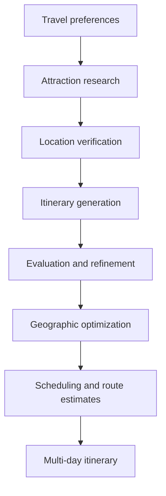

# AI Travel Architect

**An AI-powered travel planning application that turns travel preferences into personalized, multi-day itineraries.**

AI Travel Architect combines LLM orchestration, live attraction research, location verification, geographic planning, and driving-route estimates to build practical travel plans through a full-stack web application.

**[Live Demo](https://ai-travel-mosheyaku.vercel.app/)** · **[GitHub Repository](https://github.com/mosheyaku/AI_Travel_Agent)**

## Highlights

- **Agentic itinerary generation:** A multi-stage **LangGraph** workflow coordinates attraction research, itinerary generation, evaluation, refinement, optimization, and scheduling.
- **Grounded recommendations:** Uses **Tavily** for attraction research and **Google Places** to verify real-world locations before incorporating attractions into an itinerary.
- **Geographic planning:** Groups activities with location and travel constraints in mind, using **Google Routes** for driving-time and route estimates.
- **Personalized schedules:** Accounts for destination, trip duration, interests, travel pace, and optional preferences when assembling daily plans.
- **Structured, validated results:** Uses typed Python models and validation to keep itinerary data consistent across workflow stages.
- **End-to-end application:** A **FastAPI** backend and **React + TypeScript** frontend deliver a usable trip-planning experience.
- **Automated testing:** Backend tests built with **Pytest** cover API and itinerary-planning behavior.

## How It Works



The workflow brings together information retrieval, LLM-based reasoning, geographic constraints, and deterministic validation. The result is more than a list of suggested places: it is a structured plan organized by day, with activities and travel estimates.

## Technology Stack

| Layer | Technologies |
| --- | --- |
| AI orchestration | LangGraph, LangChain, OpenAI API |
| Attraction research | Tavily |
| Places and routing | Google Places API, Google Routes API |
| Backend | Python, FastAPI, Pydantic |
| Frontend | React, TypeScript, Vite, Material UI |
| Testing | Pytest |
| Deployment | Vercel (frontend), Render (backend) |

## Architecture

```text
AI_Travel_Agent/
├── backend/      # FastAPI endpoints, AI workflow, planning logic, tests
└── frontend/     # React and TypeScript web application
```

The backend is responsible for research, verification, itinerary generation, validation, optimization, and route calculations. The frontend collects trip preferences and presents the resulting day-by-day itinerary.

## Run Locally

### Prerequisites

- Python 3.13
- [uv](https://docs.astral.sh/uv/)
- Node.js and npm
- API credentials for OpenAI, Tavily, and the required Google Maps Platform services

### Backend

```bash
cd backend
uv sync
```

Configure the required environment variables in `backend/.env` using the names expected by `backend/app/config.py`. Keep API keys out of version control.

```bash
uv run uvicorn app.main:app --reload
```

The backend runs at `http://localhost:8000`. You can inspect its interactive API documentation at `http://localhost:8000/docs`.

### Frontend

In a separate terminal:

```bash
cd frontend
npm install
npm run dev
```

Open the local URL displayed by Vite. The development setup proxies API requests to the backend.

### Tests

```bash
cd backend
uv run pytest -q
```

## API Overview

| Endpoint | Purpose |
| --- | --- |
| `GET /health` | Health check |
| `GET /attractions/recommend` | Research attraction recommendations |
| `GET /attractions/search` | Search for attractions |
| `GET /places/accommodations` | Search for accommodation locations |
| `POST /trips/preferences` | Process travel preferences |
| `POST /trips/attractions` | Work with trip attractions |
| `POST /trips/generate` | Generate a multi-day itinerary |

Explore request and response schemas through FastAPI's `/docs` endpoint.

## Engineering Focus

This project explores how to turn LLM output into a useful application by combining **agentic workflows with external data, typed interfaces, validation, geographic constraints, and automated tests**. It emphasizes end-to-end software engineering: from API integrations and backend orchestration to frontend experience and public deployment.

## Live Application

**[Try AI Travel Architect](https://ai-travel-mosheyaku.vercel.app/)**

---

Built by [Moshe Yaku](https://github.com/mosheyaku).
